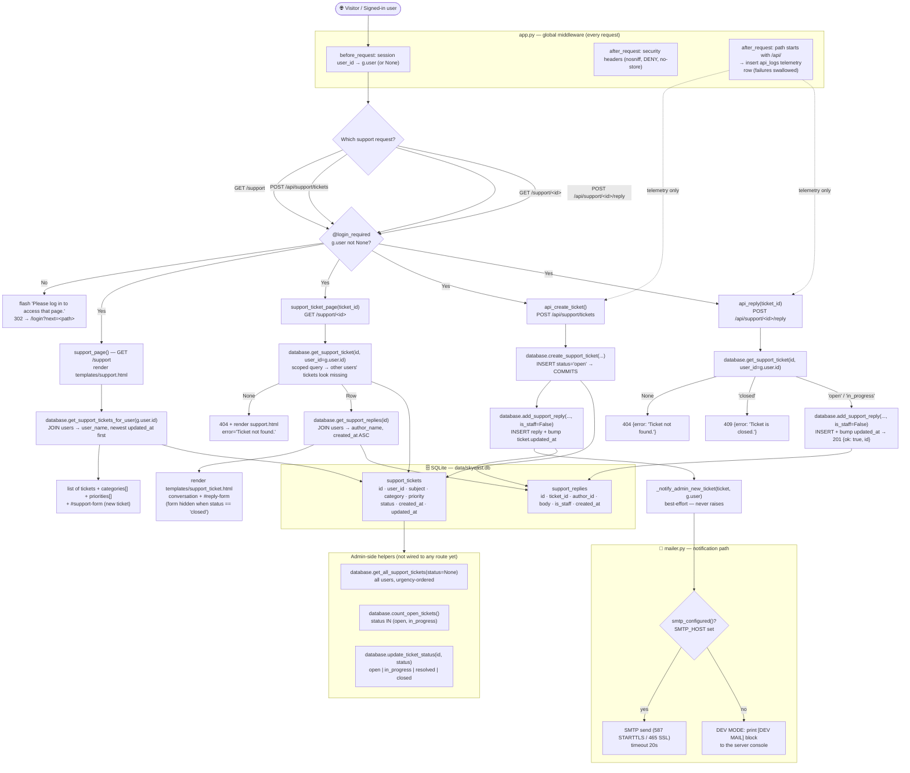
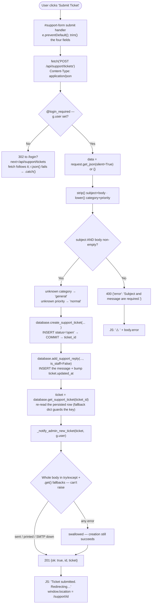
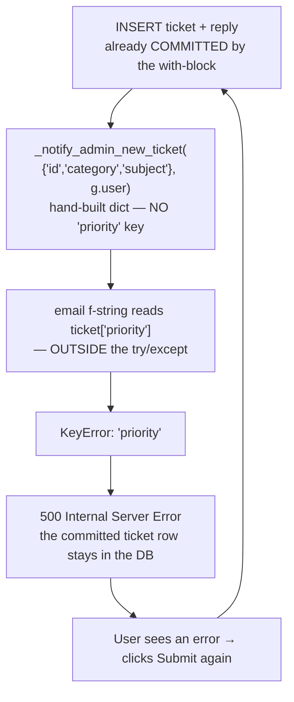
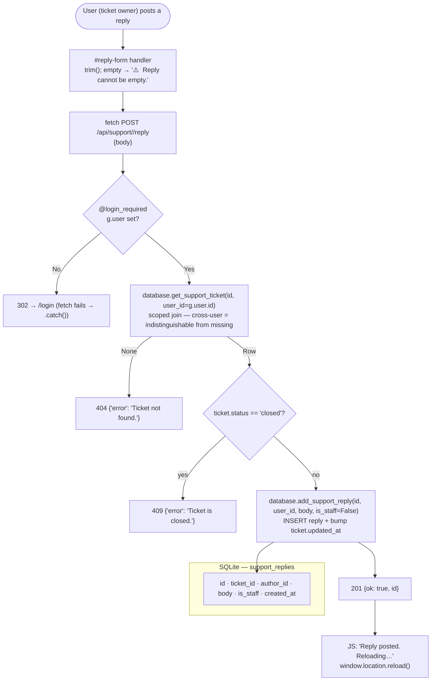
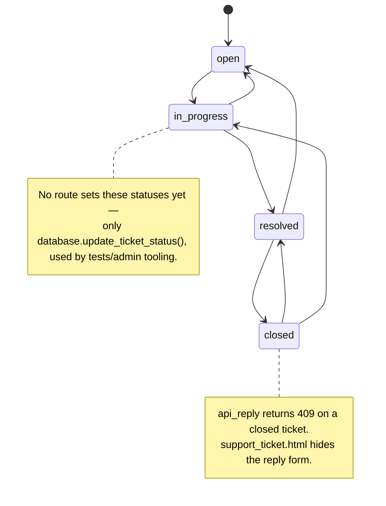

# SkyCast AI — Feedback & Support Flowchart

> Rendered from the live codebase (`routes/support.py`, `database.py`, `mailer.py`,
> `templates/support.html`, `templates/support_ticket.html`). Open this file in
> **VS Code with the Mermaid preview** (or GitHub) to see the diagrams rendered.
>
> Covers the `support_bp` blueprint only — see [`website-flowchart.md`](website-flowchart.md)
> for the whole site.

---

## 1. Master Flowchart (routes, guards, templates, data layer)



**Legend:** solid arrows = real control/data flow · dotted arrows = side effects that
never change the response (telemetry, mail) · 🔒 = `@login_required`.

---

## 2. Ticket Creation — `POST /api/support/tickets`

### 2.1 Current (fixed) happy path



### 2.2 The bug path that caused the 500 (before the fix)



> One DB row landed per click. Four clicks between `11:09:27–11:09:36` → four identical
> tickets (`#1…#4`) in `data/skycast.db` for the `execelent` report. The INSERT had
> committed before the exception, so the 500 was the user-visible symptom while the write
> had already happened — which is exactly why retries multiplied the rows.

### 2.3 Before vs after

| Aspect | Before | After |
|---|---|---|
| Notification data source | hand-built dict missing `priority` | `database.get_support_ticket(ticket_id)` (fallback dict) |
| Guard scope in `_notify_admin_new_ticket` | only `mailer.send_raw(...)` | the whole function body |
| Field access | `ticket['category']`, `ticket['priority']` | `.get()` → `general` / `normal` / `(no subject)` |
| `None` or non-dict `ticket`/`user` arg | crash | `dict(ticket or {})` normalises |
| SMTP failure | already tolerant | still tolerant |
| Result when notification fails | `500` + orphan ticket | `201` + ticket persisted |

---

## 3. Threaded Replies — `POST /api/support/<id>/reply`



## 4. Ticket Status Lifecycle



## 5. Route → Status Code Matrix

> Applies to the authenticated paths (`/support`, `/support/<id>`); anonymous requests
> are redirected (302) to `/login` by `@login_required` before reaching the handler.
> All `/api/*` traffic additionally emits a telemetry row via `_log_api_request`.

| Route | Verb | Auth | Success | Failure 1 | Failure 2 | Failure 3 |
|---|---|---|---|---|---|---|
| `/support` | GET | required | `200` ticket list | (n/a) | — | — |
| `/api/support/tickets` | POST | required | `201` `{ok,id,ticket}` | `400` empty subject/body, non-JSON, non-object | `500` *(previously — KeyError)* | — |
| `/support/<id>` | GET | required | `200` thread | `404` ticket not yours / missing | — | — |
| `/api/support/<id>/reply` | POST | required | `201` `{ok,id}` | `400` empty body / non-JSON | `404` ticket missing (scoped) | `409` ticket closed |

## 6. Data Model

| Table | Columns | Notes |
|---|---|---|
| `support_tickets` | `id` · `user_id` → users · `subject` · `category` DEFAULT `general` · `priority` DEFAULT `normal` · `status` DEFAULT `open` · `created_at` · `updated_at` | index `idx_support_user(user_id, status)` |
| `support_replies` | `id` · `ticket_id` ↓ support_tickets ON DELETE CASCADE · `author_id` → users · `body` · `is_staff` DEFAULT 0 · `created_at` | index `idx_support_replies_ticket(ticket_id)` |

Valid values: `category ∈ {general, bug, feature, billing, other}`,
`priority ∈ {low, normal, high, urgent}`, `status ∈ {open, in_progress, resolved, closed}`.

## 7. Notification Sub-flow (admin email)

`_notify_admin_new_ticket(ticket, user)` → `mailer.send_raw("admin@skycast.ai", subject, body)`:

- subject = `[SkyCast Support] #{id} {CATEGORY} — {subject}`
- body carries **Priority** (the field that used to raise `KeyError`), **Category**, From, and a reminder to open the admin console.
- `mailer.send_raw` picks the transport: if `SMTP_HOST` is set → SMTP (587 STARTTLS / 465 SSL, 20 s timeout); otherwise **DEV MODE** → prints a `[DEV MAIL]` block to the console.
- The whole helper is wrapped in `try/except` and reads every field with `.get()` and a default, so **mail never breaks ticket creation**.

## 8. Regression Coverage

| Script | What it asserts | Result |
|---|---|---|
| `verify_support_tickets.py` | 44 checks: auth redirect, the `201` regression, persistence, notification content incl. the old `Priority` key, mailer-failure tolerance, malformed-input safety, validation 400s, category/priority coercion, page renders, unknown-404, thread + closed-409, cross-user isolation, admin helpers | ✅ ALL OK (44/44, exit 0) |
| `verify_changes.py` / `verify_premium_lock*.py` | unrelated modules — not affected (no route/template/decorator changed in their surface) | pre-existing pass |

Run the guard for yourself at any time:

```bash
python verify_support_tickets.py     # uses a throwaway SKYCAST_DB under %TEMP%
```


