# SkyCast AI — Whole-Website Flowchart

> Rendered from the live codebase (`app.py` + `routes/`). Open this file in
> **VS Code with the Mermaid preview** or paste the ```mermaid blocks into
> [mermaid.live](https://mermaid.live) to see the diagrams rendered.

---

## 1. Master Flowchart — Navigation & User Flow

```mermaid
flowchart TD
    %% ================= ENTRY =================
    USER([Visitor / User / Admin]) --> LP[Landing Page / • Public]
    LP --> NAV{Navigation Intent}

    %% ================= PUBLIC PAGES =================
    NAV -->|Public tools| PUBLIC["Public Pages (no login)"]
    PUBLIC --> W[/weather • Live hourly + 7-day/]
    PUBLIC --> M[/maps • Radar & layers/]
    PUBLIC --> AB[/about • Project & tech stack/]
    PUBLIC --> AQI[/aqi • Air-quality dashboard/]
    PUBLIC --> PR[/pricing • Upgrade landing/]

    %% ================= AUTHENTICATION =================
    NAV -->|Sign up| SIGNUP[SIGN UP /signup • Auto-login]
    NAV -->|Log in| LOGIN[LOGIN /login • Unified user+admin]
    NAV -->|Forgot| FORGOT[FORGOT /forgot-password • 6-digit code]
    NAV -->|Reset| RESET[RESET /reset-password • New password]
    FORGOT --> RESET
    RESET --> LOGIN
    SIGNUP -->|auto-login| LOGIN_SUCCESS(( ))
    LOGIN -->|Valid user| LOGIN_SUCCESS
    LOGIN_SUCCESS --> DASHBOARD
    LOGIN -->|Admin creds| ADMIN_MODE
    ADMIN_MODE --> ADM[ADMIN MASTER /admin/ • Admin-only]

    %% ================= USER AREA =================
    subgraph DASH_AREA["User Area — login_required"]
        DASHBOARD[/dashboard • Saved cities + telemetry/]
        SET[/settings • Preferences/]
        SUP[/support • Ticket list/]
        API_Portal[/developers • API key management/]
    end
    USER -->|After login| DASHBOARD

    %% --- Explore dropdown (login_required, free tier) ---
    DASHBOARD --> EXPL[EXPLORE Dropdown]
    EXPL --> HEALTH[/health • Symptom & allergen index/]
    EXPL --> PLANNER[/planner • Event & activity planner/]
    EXPL --> ROUTE[/route • Smart commute/]

    %% --- Specialized dropdown (PREMIUM required) ---
    DASHBOARD --> SPEC[Specialized Dropdown • premium_required]
    SPEC -->|Free user| PREMIUM_GATE[Premium gate → /pricing]
    PREMIUM_GATE --> PR
    PR -->|Stripe checkout| CHECKOUT[POST /api/billing/checkout]
    CHECKOUT -->|Redirect| SUCCESS[GET /billing/success • Grants premium]
    SUCCESS --> PREMIUM_OK[Premium Active]
    PREMIUM_OK --> SPEC
    PR -->|No Stripe| DEMO_UPGRADE[POST /api/account/subscription • Demo toggle]
    DEMO_UPGRADE --> PREMIUM_OK

    %% --- Insights dropdown (PREMIUM required) ---
    DASHBOARD --> INS[Insights Dropdown • premium_required]
    
    %% --- Specialized & Insights premium pages ---
    SPEC --> SOLAR[/solar • Solar ROI calculator/]
    SPEC --> AGRI[/agriculture • Soil & ET0 analytics/]
    SPEC --> HIST[/historical • 30-yr climate baselines/]
    INS --> ASST[/assistant • AI chat + packing/]
    INS --> PRED[/predictions • AI Prediction Engine/]
    INS --> ALERTS[/alerts • Active Alerts/]
    INS --> DISAST[/disaster • Shelter locator + helplines/]

    %% --- Subscription management ---
    DASHBOARD --> CANCEL[POST /api/user/subscription/cancel • Downgrade]
    CANCEL --> DASHBOARD

    %% --- Admin Console sub-pages ---
    ADM --> ADM_SYS[SYSTEM /admin/system • Cluster health]
    ADM --> ADM_RPT[REPORT /admin/report • Printable climate report]
    ADM --> ADM_CC[COMMAND CENTER /admin/command-center • Flags, broadcasts, keys]

    %% ================= API / DATA LAYER =================
    subgraph API["API / Data Layer (JSON)"]
        direction TB
        API_W[/GET /api/summary?city=/]
        API_B[/GET /api/banners/]
        API_AQI[/GET /api/v1/aqi/forecast/]
        API_C[/GET /api/cities/]
        API_SC[/GET/POST/DELETE /api/user/saved-cities/]
        API_CAN[/POST /api/user/subscription/cancel/]
        API_P[/GET /api/planner/]
        API_H[/GET /api/health/]
        API_L[/GET /api/lightning/]
        API_ASST[/GET /api/assistant, /api/search, POST /api/packing/]
        API_PRED[/GET /api/predictions/weekly, /outfit, /routes, /relief/]
        API_AL[/GET/POST /api/alerts, DELETE /api/alerts/<id>, POST /api/alerts/test/]
        API_DIS[/GET /api/disaster/]
        API_HIST[/GET /api/historical/]
        API_SOL[/GET /api/solar/]
        API_AG[/GET /api/agriculture/]
        API_R[/POST /api/route/smart-commute/]
        API_SAF[/GET /api/v1/safety/helplines, /advisory, /shelters/]
        API_ADM[/GET /api/admin/dashboard-summary, /api/users, /api/admin/feature-flags, /api/admin/api-keys/]
        API_TEL[/GET /api/analyst/telemetry/stream SSE, /api/telemetry/*/]
        API_ANA[/GET /api/v1/analytics/weather-trends, /air-quality-history, /model-accuracy/]
        API_DEV[/GET/POST /api/v1/weather, /api/v1/forecast, POST /api/keys, POST /api/playground/]
        API_PAY[/POST /api/billing/checkout, /api/billing/portal, POST /api/billing/webhook/]
        API_NOT[/POST /api/notifications/subscribe, /unsubscribe/]
    end

    %% --- Page-to-API connections ---
    W --> API_W
    AQI --> API_AQI
    DASHBOARD --> API_SC
    CANCEL --> API_CAN
    HEALTH --> API_H
    PLANNER --> API_P
    ASST --> API_ASST
    PRED --> API_PRED
    ALERTS --> API_AL
    DISAST --> API_DIS
    SOLAR --> API_SOL
    AGRI --> API_AG
    HIST --> API_HIST
    ROUTE --> API_R
    PR --> API_PAY
    API_Portal --> API_DEV
    ADM --> API_ADM

    %% ================= STYLES =================
    classDef public fill:#475569,stroke:#6474a0,color:#fff
    classDef auth fill:#0284c7,stroke:#0ea5e9,color:#fff
    classDef premium fill:#d97706,stroke:#f59e0b,color:#000
    classDef admin fill:#b91c1c,stroke:#ef4444,color:#fff
    classDef api fill:#7c3aed,stroke:#8b5cf6,color:#fff
    classDef landing fill:#0f172a,stroke:#1e293b,color:#fff
    classDef billing fill:#059669,stroke:#10b981,color:#fff

    class LP,W,M,AB,AQI,PR,SET,SUP,LOGIN,SIGNUP,FORGOT,RESET,DASH_AREA public
    class DASH_AREA,SPEC,INS,HEALTH,PLANNER,ROUTE,API_Portal,SOLAR,AGRI,HIST,ASST,PRED,ALERTS,DISAST public
    class ADM,ADM_SYS,ADM_RPT,ADM_CC,ADMIN_MODE admin
    class API_W,API_B,API_AQI,API_C,API_SC,API_CAN,API_P,API_H,API_L,API_ASST,API_PRED,API_AL,API_DIS,API_HIST,API_SOL,API_AG,API_R,API_SAF,API_ADM,API_TEL,API_ANA,API_DEV,API_NOT api
    class LP landing
    class CHECKOUT,SUCCESS,DEMO_UPGRADE,CANCEL,PREMIUM_GATE,PREMIUM_GATE2,PREMIUM_OK,PREMIUM_OK2,API_PAY billing
```




Render this in [mermaid.live](https://mermaid.live) → **Download as SVG** → drop into your slide deck.

---

## 2. Full Route Catalogue

### 🟦 Public Pages (no login required)

| Route | Template | Purpose |
|---|---|---|
| `/` | `index.html` | Breathing-sky homepage — glassmorphism + parallax clouds |
| `/weather` | `weather.html` | Live weather — hourly + 7-day forecast (Open-Meteo, keyless) |
| `/maps` | `maps.html` | Radar & layer maps — Leaflet + Open-Meteo tiles |
| `/about` | `about.html` | Project overview + tech stack |
| `/aqi` | `aqi.html` | Air-quality dashboard — 24h PM₂.₅ / O₃ / NO₂ / US AQI |
| `/pricing` | `pages/pricing.html` | Upgrade landing — Stripe + demo toggle |

### 🔌 JSON API Endpoints

#### **Public APIs (no auth key)**

| Endpoint | Purpose |
|---|---|
| `GET /api/summary?city=` | Extreme-weather AI summarizer — 2-sentence banner |
| `GET /api/banners` | Global severe-condition toasts (AQI>200, heatwave, storms) |
| `GET /api/v1/aqi/forecast?city=` | 24h AQI forecast — PM₂.₅/PM₁₀/O₃/NO₂ + US AQI |
| `GET /api/cities` | City directory grouped by country |
| `GET /api/planner?city=&event=&days=` | Event planner AI recommendations |
| `GET /api/health?city=` | Health index data — migraine/asthma/joint/UV bands |
| `GET /api/lightning?city=` | Live lightning & storm cell tracker |
| `GET /api/search?q=` | Natural-language weather search — e.g. "karachi tomorrow" |
| `GET /api/v1/safety/helplines` | Emergency helpline directory (Pakistan) |
| `GET /api/v1/safety/advisory?condition=` | Safety protocol by hazard type |
| `GET /api/v1/safety/shelters?lat=&lng=` | Shelter geolocation lookup (Haversine) |
| `GET /api/v1/analytics/weather-trends?location=` | 7-day climate trends — temp/humidity/rainfall |
| `GET /api/v1/analytics/air-quality-history` | 24h AQI history |

#### **Auth-Required APIs**

| Endpoint | Method | Auth | Purpose |
|---|---|---|---|
| `/api/user/saved-cities` | GET | login | List saved cities |
| `/api/user/saved-cities` | POST | login | Add saved city |
| `/api/user/saved-cities/<city>` | DELETE | login | Remove saved city |
| `/api/user/subscription/cancel` | POST | login | Downgrade to Free (instant Premium eviction) |
| `/api/account/subscription` | POST | login | Demo toggle: `{"plan":"free"|"premium"}` |
| `/api/notifications/subscribe` | POST | login | Save push subscription |
| `/api/notifications/unsubscribe` | POST | login | Delete push subscription |
| `/api/alerts` | GET | login | List user alerts + notification log |
| `/api/alerts` | POST | login | Create threshold alert |
| `/api/alerts/<id>` | DELETE | login | Revoke alert |
| `/api/alerts/test` | POST | login | Evaluate alerts vs live weather |
| `/api/assistant` | GET/POST | premium | AI assistant chat |
| `/api/packing` | POST | premium | Hourly packing advice |
| `/api/predictions/weekly?city=` | GET | premium | 7-day AI forecast |
| `/api/predictions/outfit?city=` | GET | premium | Clothing recommendations |
| `/api/predictions/routes?city=` | GET | premium | Safe route suggestions |
| `/api/predictions/relief?city=` | GET | premium | Relief camps + helplines |
| `/api/disaster?city=` | GET | premium | Hazard assessment + shelters |
| `/api/historical?city=` | GET | premium | Climate baselines |
| `/api/solar?city=&kw_capacity=&panel_efficiency=` | GET | premium | Solar estimates |
| `/api/agriculture?city=&day_offset=` | GET | premium | Soil analytics |
| `/api/route/smart-commute` | POST | login | Time-series route weather — waypoint hazard scan |
| `/api/user/preferences` | POST | login | Save user preferences |
| `/api/keys` | POST | login | Create new API key |
| `/api/playground` | POST | login | API playground proxy — proxied `/api/v1/*` calls |

#### **API Key Required (rate-limited, 60/min)**

| Endpoint | Purpose |
|---|---|
| `GET /api/v1/weather?city=` | Rate-limited weather JSON |
| `GET /api/v1/forecast?city=` | Rate-limited forecast JSON |

#### **Admin APIs (admin-only)**

| Endpoint | Method | Purpose |
|---|---|---|
| `/api/admin/dashboard-summary` | GET | Aggregate KPIs — users, keys, requests today, alerts |
| `/api/users` | GET | Registered users with alert/API-key counts |
| `/api/users/<id>` | DELETE | Delete user + owned records (cannot self-delete) |
| `/api/users/<id>/role` | POST | Change user role (user/analyst/admin) |
| `/api/users/<id>/plan` | POST | Change subscription plan |
| `/api/admin/feature-flags` | GET/POST | System feature flags — radar, AI assistant, offline, maintenance |
| `/api/admin/api-keys` | GET/PATCH | API key tier management (Free/Pro/Enterprise) |
| `/api/admin/broadcast/geofence` | POST | Geofenced emergency broadcast (ADMIN_BROADCAST perm) |
| `/api/admin/data/backup?keep=14` | POST | On-demand gzipped SQLite backup |
| `/api/admin/data/backups` | GET | Backup archive inventory |
| `/api/admin/data/vacuum` | POST | SQLite VACUUM |

#### **Analyst APIs (analyst+ role)**

| Endpoint | Method | Purpose |
|---|---|---|
| `/api/analyst/telemetry/stream` | GET | SSE live telemetry — p50/p95/p99 latency, 5xx, req/s (5-min window) |
| `/api/v1/analytics/system/usage` | GET | Platform usage metrics + active sessions |
| `/api/v1/analytics/system/api-health` | GET | Latency logs + third-party API status |
| `/api/v1/analytics/model-accuracy?city=&model=&days=` | GET | Model drift analytics — MAE/RMSE from MongoDB |
| `/api/v1/analytics/model-accuracy/log` | POST | Persist predicted-vs-actual observation |
| `/api/v1/analytics/simulate-alert/history?limit=` | GET | Recent analyst dry-run simulations |
| `/api/analyst/ingest` | POST | Multi-part CSV/JSON/JSONL upload — bulk climate data ingestion |
| `/api/analyst/climate/correlations?city=&days=&workers=` | GET | MapReduce Pearson correlations (temp vs AQI vs humidity vs wind) |
| `/api/analyst/climate/trends?city=&horizon=` | GET | Linear trend forecast over horizon hours |
| `/api/analyst/alerts/dry-run` | POST | Evaluate mock conditions against user-defined alert rules |
| `/api/analyst/composite-index/calculate` | POST | Heat Stress Index / Wildfire Danger Rating / Crop Thermal Stress |
| `/api/analyst/export/geojson` | POST | Spatial log export within bbox → GeoJSON |
| `/api/telemetry/hadoop/jobs` | POST | Submit Hadoop job (daily_summary / aqi_averages / extreme_events) |
| `/api/telemetry/hadoop/jobs/<job_id>` | GET | Job status |
| `/api/telemetry/export?format=&range=` | GET | Export metrics (JSON/CSV) |

---

## 3. Roles & Permissions Matrix

| Pages | Anonymous | User (Free) | User (Premium) | Analyst | Admin |
|---|---|---|---|---|---|
| **Public** (/, /weather, /maps, /about, /aqi, /pricing) | ✅ | ✅ | ✅ | ✅ | ✅ |
| **Auth** (/signup, /login, /forgot-password, /reset-password) | ✅ | ❌ | ❌ | ❌ | ✅ |
| **User area** (/dashboard, /settings, /support, /support/<id>, /developers) | ❌ | ✅ | ✅ | ✅ | ✅ (via user acct) |
| **Explore** (/health, /planner, /route) | ❌ | ✅ | ✅ | ✅ | ✅ |
| **Specialized** (/solar, /agriculture, /historical) | ❌ | ❌ → redirect to /pricing | ✅ | ✅ | ✅ |
| **Insights** (/assistant, /predictions, /alerts, /disaster) | ❌ | ❌ → redirect to /pricing | ✅ | ✅ | ✅ |
| **Admin console** (/admin/ + sub-pages) | ❌ | ❌ | ❌ | ❌ | ✅ |
| **Analyst APIs** (telemetry, data engineering, drift, simulation) | ❌ | ❌ (401/403) | ❌ (401/403) | ✅ | ✅ |
| **Billing** (/api/billing/*, /billing/*) | ❌ | ✅ (checkout/portal/cancel) | ✅ | ❌ | ❌ |

### Permission Bits (security/permissions.py)

| Permission | Who has it |
|---|---|
| ANALYST_METRICS | Analyst + Admin |
| ANALYST_EXPORT | Analyst + Admin |
| ADMIN_FLAGS | Admin only |
| ADMIN_BROADCAST | Admin only |

## 4. Blueprint Registration (from app.py)

| Blueprint | Prefix | Import source |
|---|---|---|
| `safety_bp` | `/` | `routes.safety` |
| `smart_bp` | `/` | `routes.smart_features` |
| `admin_bp` | `/admin` | `routes.admin` |
| `admin_ext_bp` | `/admin` | `routes.admin_features` (command-center, feature-flags, broadcasts, api-keys) |
| `analytics_bp` | `/` | `routes.analytics` |
| `predictions_bp` | `/` | `routes.predictions` |
| `api_portal_bp` | `/` | `routes.api_portal` (developers, v1 developer API) |
| `alerts_bp` | `/` | `routes.alerts` |
| `assistant_bp` | `/` | `routes.assistant` |
| `auth_bp` | `/` | `routes.auth` |
| `disaster_bp` | `/` | `routes.disaster` |
| `insights_bp` | `/` | `routes.insights` (summary, banners, AQI forecast, AQI dashboard) |
| `pages_bp` | `/` | `routes.pages` (landing, weather, maps, dashboard, about, settings, health, planner, pricing, lightning) |
| `specialized_bp` | `/` | `routes.specialized` (solar, agriculture, historical) |
| `support_bp` | `/` | `routes.support` |
| `analyst_bp` | `/` | `routes.analyst_tools` (dry-run, composite index, geojson export) |
| `admin_broadcast_bp` | `/` | `routes.admin_broadcast` |
| `sse_bp` | `/` | `routes.telemetry_sse` |
| `analyst_drift_bp` | `/` | `routes.analyst_drift` |
| `data_eng_bp` | `/` | `routes.data_engineering` |
| `billing_bp` | `/` | `routes.billing` |
| `notifications_bp` | `/` | `routes.notifications` |

---

## 5. How to Render This for Your Presentation

1. **Copy the ```mermaid block** from Section 1 (lines 11–148) into [mermaid.live](https://mermaid.live).
2. Click **Download SVG** → drop the SVG onto your slide.
3. The diagram is color-coded:
   - Navy = Public pages
   - Blue = Auth-required pages
   - Amber = Premium pages (gated by Stripe or demo toggle)
   - Red = Admin console
   - Purple = JSON API layer
   - Dark = Landing page entry
   - Green = Billing flow

> **Tip:** If the diagram is too dense for one slide, split it: use Section 1 as-is for "User Journey + Premium Gates" and create a second simplified diagram that only includes the API subgraph + page-to-API connections for a "Backend Architecture" slide.
